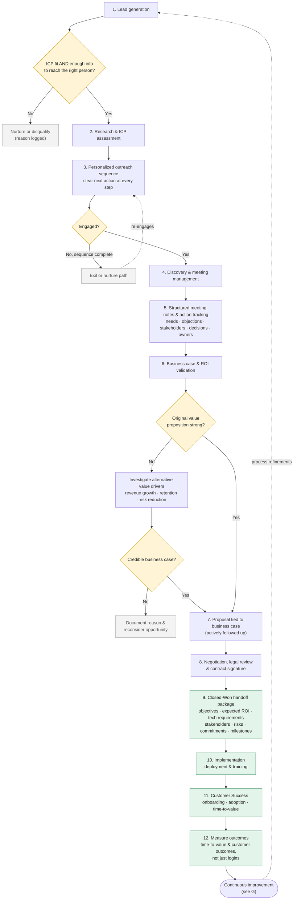
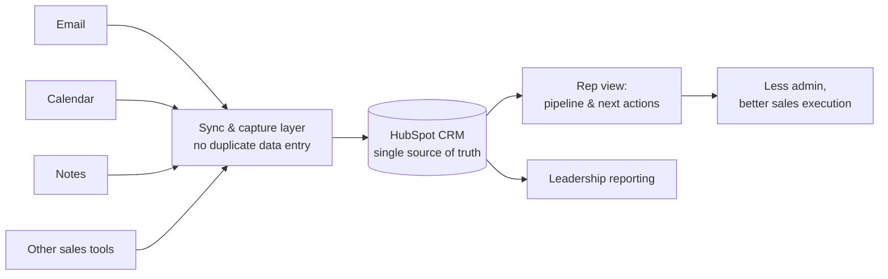
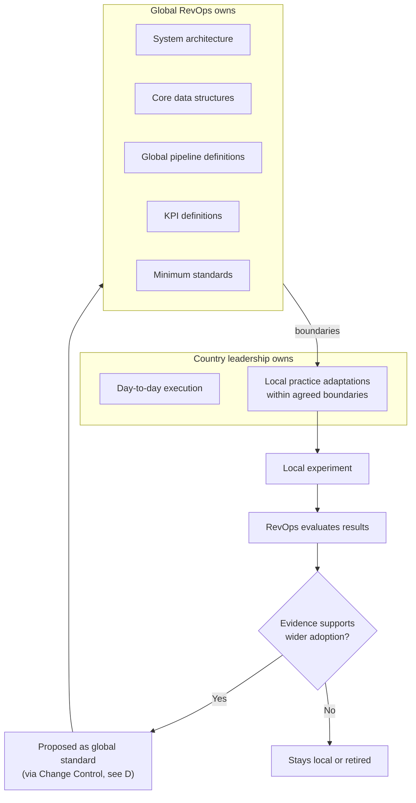
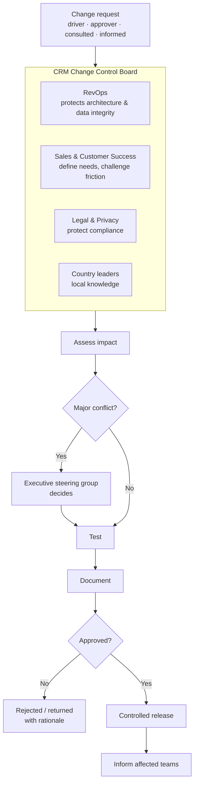
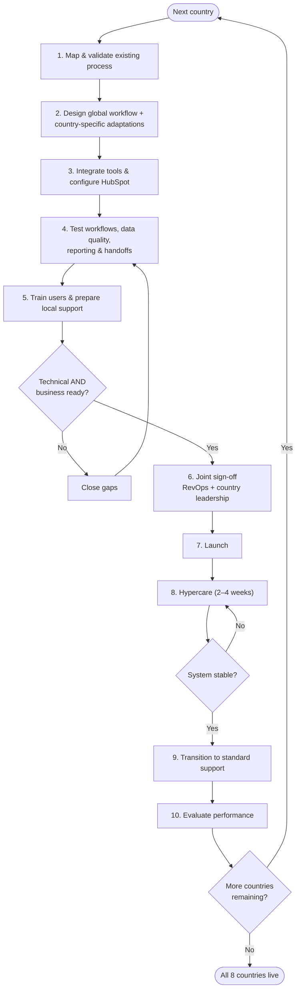
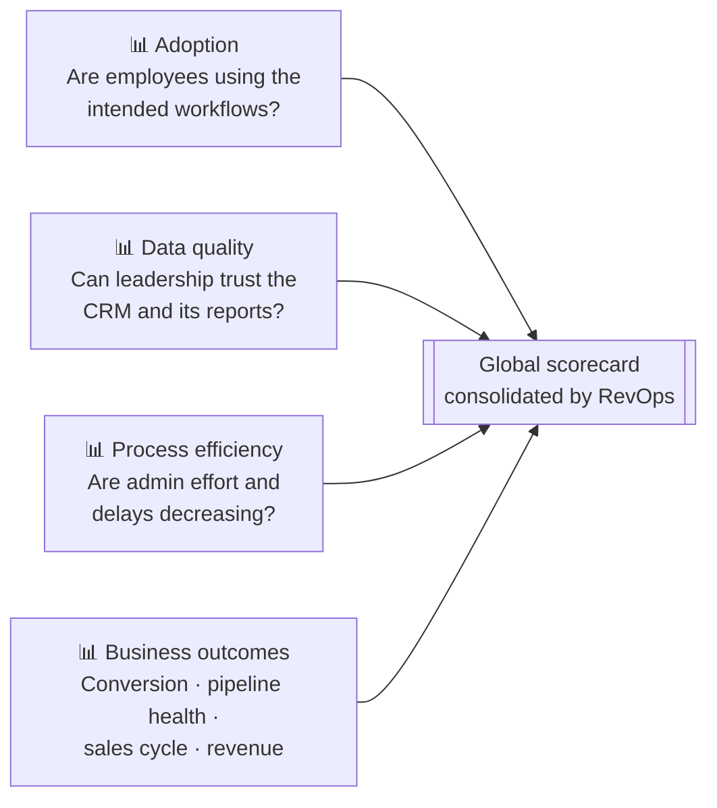
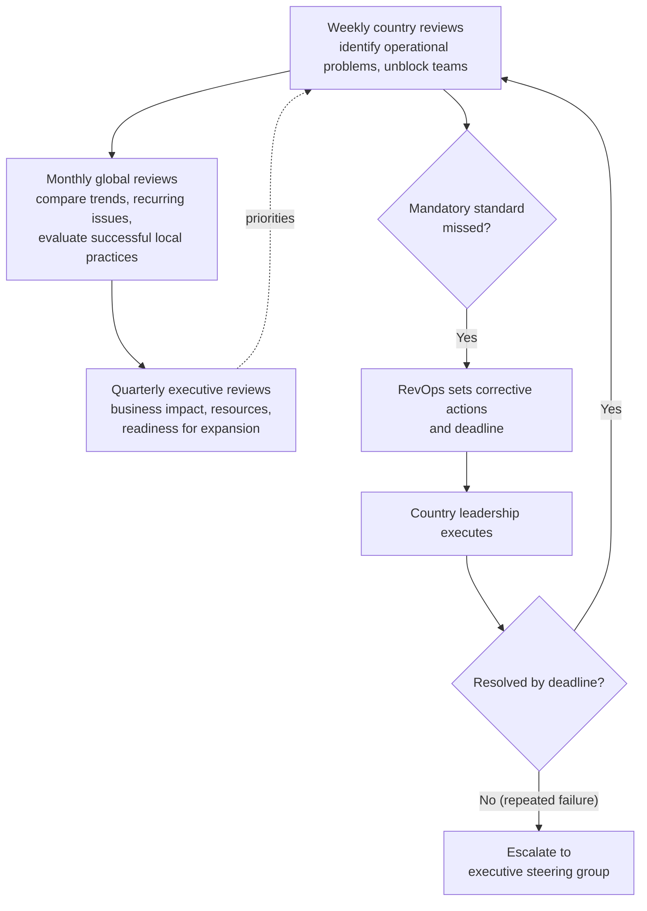
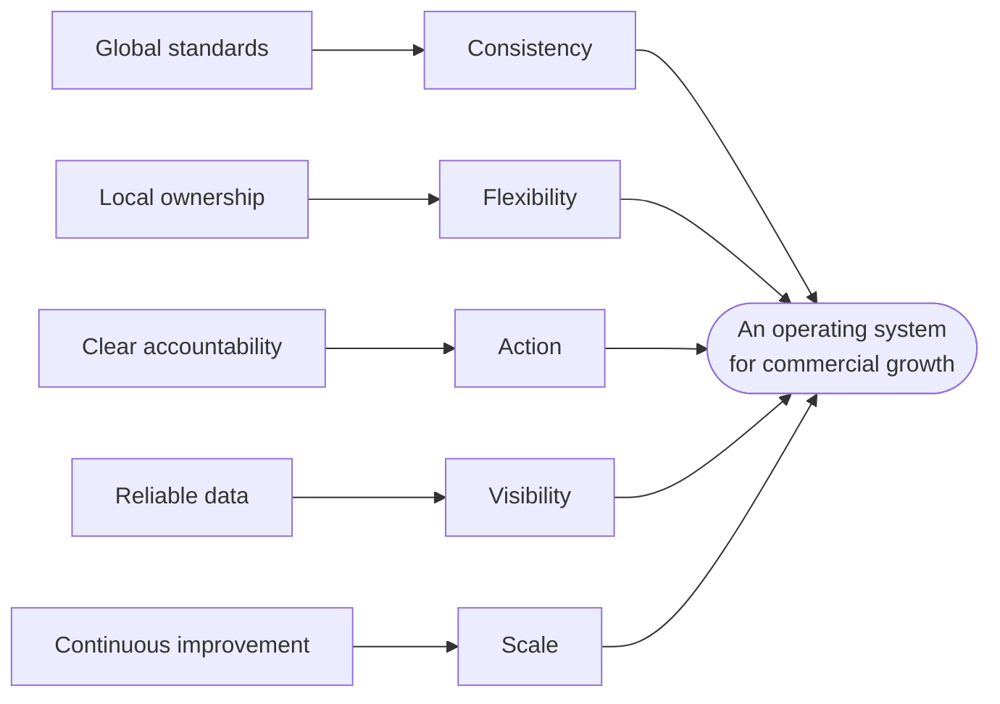

# Global CRM Transformation — Operating Model Workflow

> A global CRM transformation is not just a technology project. It's a people, process, and governance project.

Guiding question: **How do we help salespeople spend less time on administration and more time finding leads, building relationships, and closing deals?**

The model is split into connected sub-workflows. Each diagram below is a node graph (rendered by GitHub's Mermaid support). The same nodes and edges are available in machine-readable form in [`workflow.json`](workflow.json).

**Interactive version:** [`index.html`](index.html) is a self-contained node map of all eight sub-workflows. Download it and open it in a browser (or serve the repo with GitHub Pages). It supports pan and zoom, click-through to each node's inputs and outputs, a step-by-step walk-through, search, and per-node "done" tracking saved in your browser.

| # | Sub-workflow | Source principle |
| --- | --- | --- |
| A | [End-to-end customer journey](#a-end-to-end-customer-journey) | 1, 5, 6 |
| B | [Tool integration](#b-tool-integration) | 2 |
| C | [Global standard, local flexibility](#c-global-standard-local-flexibility) | 3 |
| D | [Change control and decision rights](#d-change-control-and-decision-rights) | 4 |
| E | [Country-by-country rollout](#e-country-by-country-rollout) | 7 |
| F | [Balanced scorecard](#f-balanced-scorecard) | 8 |
| G | [Continuous improvement cadence](#g-continuous-improvement-cadence) | 9 |
| H | [Guiding principles](#h-guiding-principles) | 10 |

---

## A. End-to-end customer journey

One connected workflow across the whole lifecycle, with evidence-driven gates so customer information never disappears between teams.

**Ownership after signature:** Implementation owns deployment and training. Customer Success owns long-term adoption and value realization. Sales supports the transition where needed.

---

## B. Tool integration

Integrate the tools people already use instead of forcing them to abandon them. The objective is less administrative friction, not more CRM activity.

---

## C. Global standard, local flexibility

One global system, not eight disconnected ones.

---

## D. Change control and decision rights

Every proposed change has a clear **driver, approver, consulted stakeholders, and informed teams**.

---

## E. Country-by-country rollout

Eight countries, one at a time. A country does not go live just because configuration is finished — **technical readiness and business readiness both matter**.

---

## F. Balanced scorecard

| Metric area | Owner |
| --- | --- |
| CRM and process metrics | RevOps |
| Sales outcomes | Sales |
| Post-sale outcomes | Customer Success |
| Global scorecard consolidation | RevOps |

---

## G. Continuous improvement cadence

---

## H. Guiding principles

Governance is an enabler, not bureaucracy.

**Takeaway:** a CRM transformation succeeds when technology, processes, governance, and employee behaviour are designed together — not when a new system is simply switched on.
