# Global CRM Transformation: the complete operating model

<!-- Generated by build.py from src/model.py. Edit the model, then run `python3 build.py`. -->

**Goal:** Build a global commercial operating model that reduces administrative work, improves lead conversion, gives leadership trustworthy data, and connects sales activity to customer value.

| Programme duration | Geographic scope | System of focus | Global process owner |
| --- | --- | --- | --- |
| 8 months | 8 countries | HubSpot CRM | Global RevOps |

**Primary objective:** Reduce manual administration so employees can spend more time finding qualified leads, building relationships, and closing deals.

**Supporting objectives:** Improve data reliability, forecasting, customer handoffs, onboarding, and measurable customer outcomes.

## How to use this

- **[`index.html`](index.html)** is the interactive map: every workflow as a node graph, with owners, required information, walk-through, search, reference tables and per-node progress tracking. Download it and open it in a browser.
- **[`workflow.json`](workflow.json)** has the same nodes, edges and tables in machine-readable form.
- **[`src/model.py`](src/model.py)** is the single source. Edit it and run `python3 build.py` to regenerate all three files.

### Decision status

| Marker | Status | Meaning |
| --- | --- | --- |
| solid outline | Established | A decision already made in the operating model. |
| dashed violet outline | Proposed | A proposed starting point or target. Confirm it against baseline data before relying on it. |
| dotted red outline | Validate in Month 1 | An open assumption. Answer it during discovery before finalising architecture, budget, targets or sequencing. |

## Workflows

**Lifecycle**

- [A. Customer lifecycle overview](#a-customer-lifecycle-overview) (Section 2)
- [B. Lead to opportunity](#b-lead-to-opportunity) (Stages 1–3)
- [C. Opportunity to signature](#c-opportunity-to-signature) (Stages 4–5)
- [D. Handoff to renewal](#d-handoff-to-renewal) (Stages 6–8)
- [E. Stage gates & SLAs](#e-stage-gates--slas) (Section 3)
**Platform**

- [F. Integrations & data governance](#f-integrations--data-governance) (Section 4A, 4C)
- [G. Data migration](#g-data-migration) (Section 4B)
- [H. Privacy & security by design](#h-privacy--security-by-design) (Section 4D)
**Governance**

- [I. Governance & change control](#i-governance--change-control) (Section 5)
- [J. Review cadence & corrective action](#j-review-cadence--corrective-action) (Sections 9–10 (earlier model))
**Rollout**

- [K. Eight-month rollout](#k-eight-month-rollout) (Section 7)
**Measure & improve**

- [L. Scorecard & measurement](#l-scorecard--measurement) (Section 8)
- [M. Local innovation loop](#m-local-innovation-loop) (Section 9)
- [N. Adoption & change management](#n-adoption--change-management) (Section 10)
**Principles**

- [O. Operating principles](#o-operating-principles) (Sections 1 & 14)

**Reference tables**

- [Stage gates: minimum evidence before progression](#stage-gates-minimum-evidence-before-progression)
- [Integration design decisions](#integration-design-decisions)
- [Decision-rights matrix](#decision-rights-matrix)
- [Locked globally vs. flexible locally](#locked-globally-vs-flexible-locally)
- [Tiered change control](#tiered-change-control)
- [Programme RACI](#programme-raci)
- [Global scorecard KPIs](#global-scorecard-kpis)
- [Risk register](#risk-register)
- [Programme deliverables](#programme-deliverables)
- [Assumptions to validate in Month 1](#assumptions-to-validate-in-month-1)

---

## A. Customer lifecycle overview

*Section 2.* Eight stages from the first marketing interaction to renewal, expansion and advocacy. Each stage has an accountable owner, required information, a measurable exit condition and a defined next step.

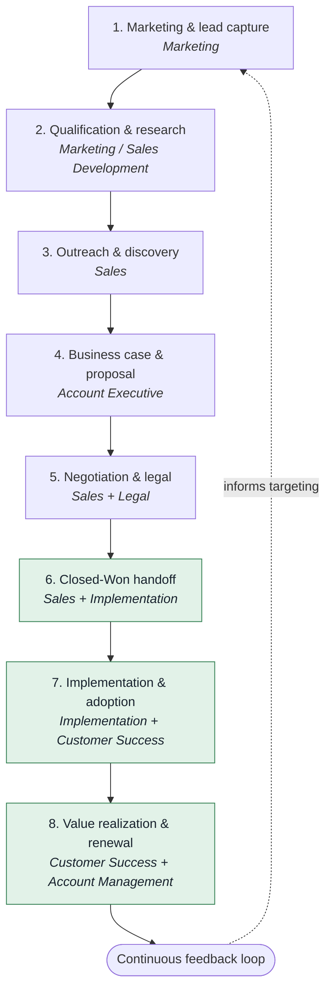

---

## B. Lead to opportunity

*Stages 1–3.* Explicit lead lifecycle, evidence-based qualification and a structured outreach sequence. An incomplete profile is not the same as a bad-fit account.

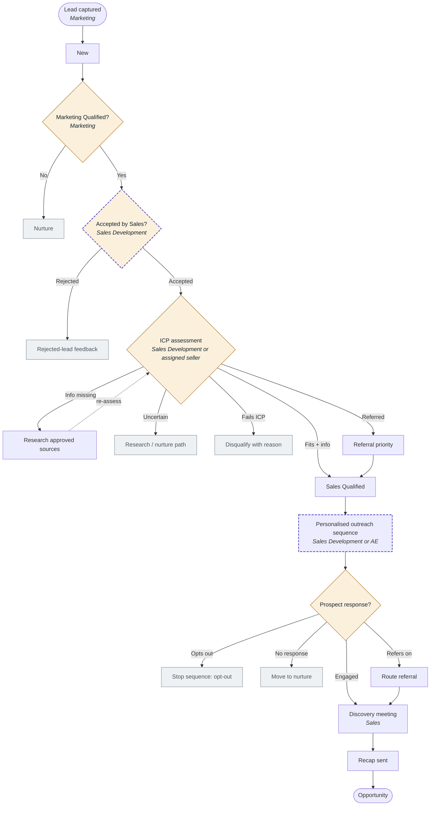

---

## C. Opportunity to signature

*Stages 4–5.* Proposals are tied to an evidence-based business case. Silence triggers investigation, not automatic closure. Commercial pressure cannot override mandatory legal, privacy or security requirements.

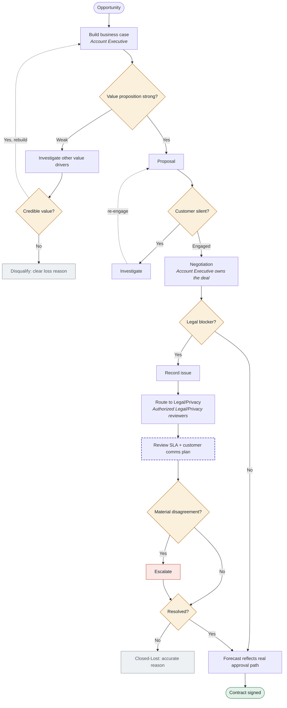

---

## D. Handoff to renewal

*Stages 6–8.* Closing is not the end of the workflow. Sales owns handoff completeness, Implementation owns deployment, Customer Success owns long-term adoption and value realization.

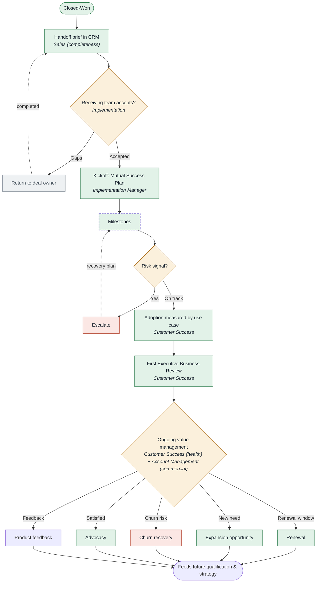

---

## E. Stage gates & SLAs

*Section 3.* A stage is a verifiable state of the customer relationship, not a label. Automations flag overdue work and prompt people to act. They never mark an opportunity lost because a timer expired.

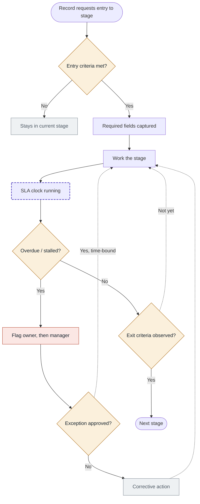

---

## F. Integrations & data governance

*Section 4A, 4C.* One globally consistent data model. Integrations reduce manual work; they must not create duplicates or conflicting sources of truth. Example rules are illustrative, not assumptions about current systems.

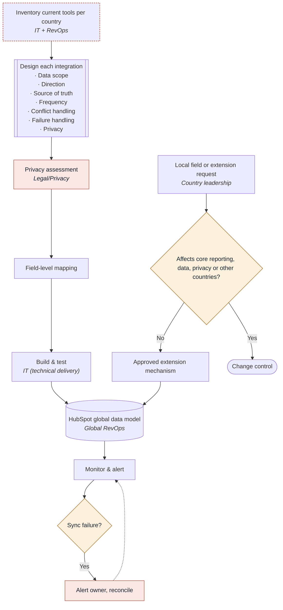

---

## G. Data migration

*Section 4B.* A dedicated workstream, not a last-minute technical task. Legacy systems are not decommissioned just because HubSpot is live.

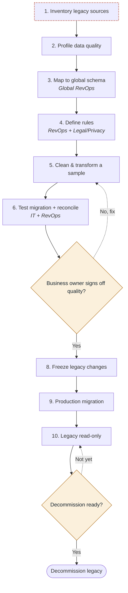

---

## H. Privacy & security by design

*Section 4D.* Legal, Privacy and Security are involved during architecture and migration, not only when a change reaches the board. Choosing a hosting region alone does not resolve privacy obligations.

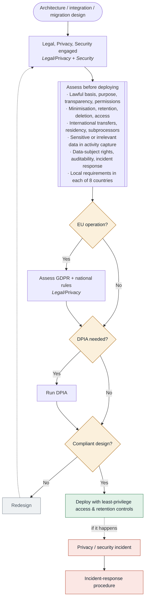

---

## I. Governance & change control

*Section 5.* Governance matches the risk of the change. System ownership (RevOps) is separate from business process ownership. Consultation is shared; decision rights are explicit.

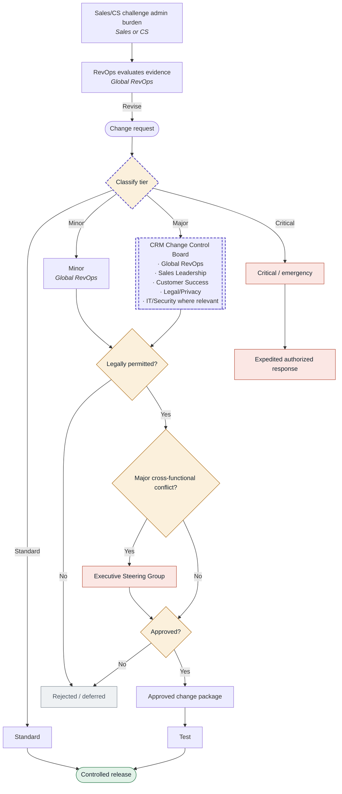

---

## J. Review cadence & corrective action

*Sections 9–10 (earlier model).* Weekly country reviews unblock teams, monthly global reviews compare trends and spot successful experiments, quarterly executive reviews assess impact and expansion readiness.

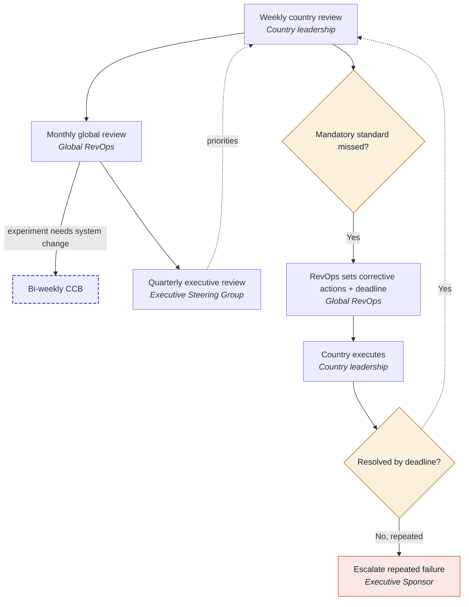

---

## K. Eight-month rollout

*Section 7.* Global foundation first, then a pilot country, then waves sized by readiness and support capacity. The schedule is a planning hypothesis, not a guaranteed date.

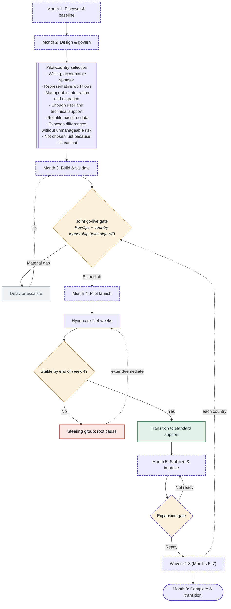

---

## L. Scorecard & measurement

*Section 8.* Measures whether the transformation achieves its purpose, not just whether HubSpot is used. Every KPI has a definition, baseline, target, data source, owner and review frequency.

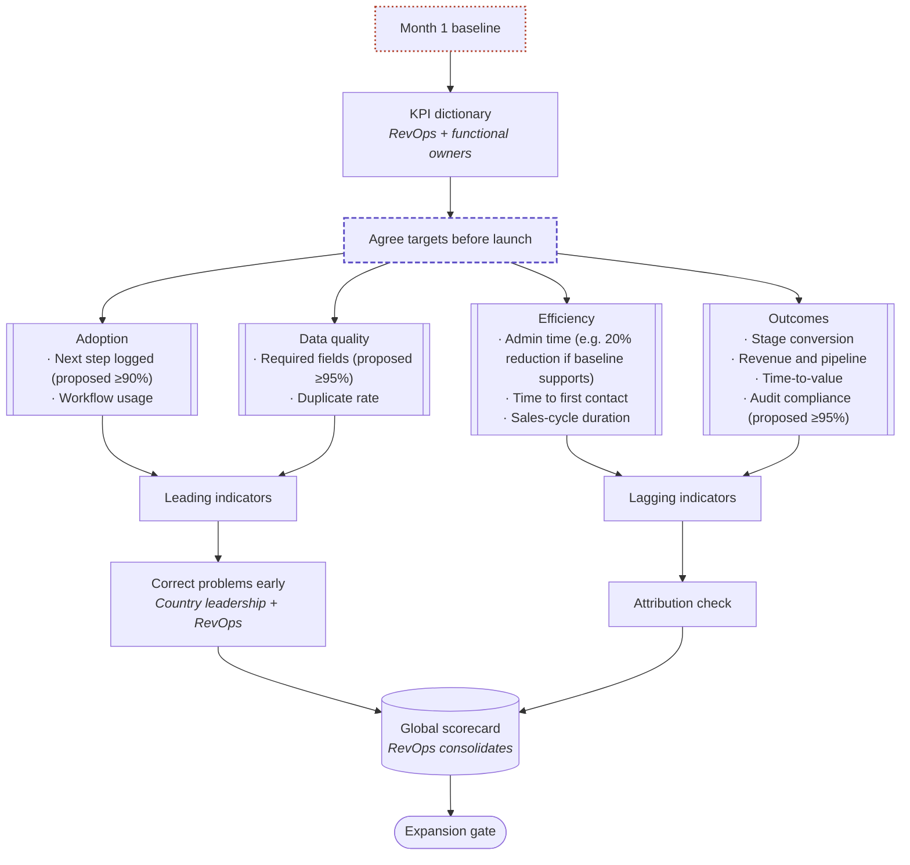

---

## M. Local innovation loop

*Section 9.* The model gets better with each country. A reported improvement is a signal to examine, not proof.

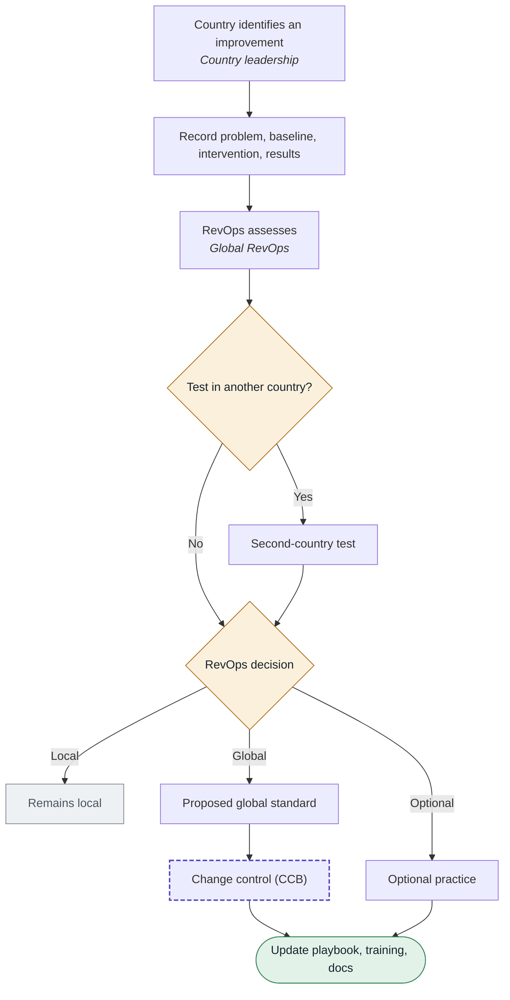

---

## N. Adoption & change management

*Section 10.* Resistance is not automatically a training problem. It can reveal poor workflow design, duplicated entry, unclear value or conflicting incentives.

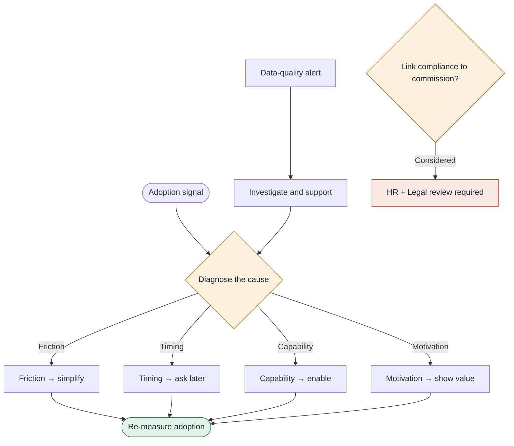

---

## O. Operating principles

*Sections 1 & 14.* Six design principles and the five outcomes the model is built to produce.

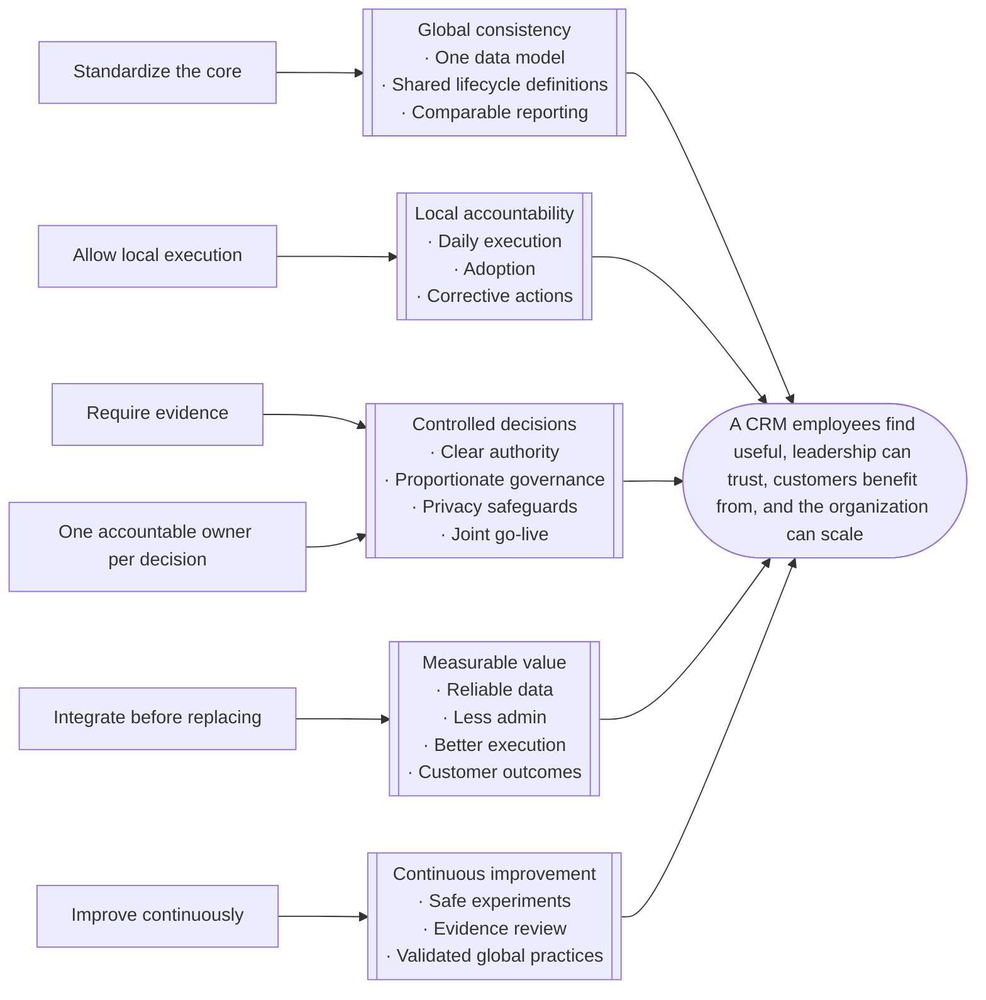

---

# Reference tables

## Stage gates: minimum evidence before progression

*Section 3.* Exact HubSpot properties and enforcement rules are finalised during process design.

| Stage | Minimum evidence |
| --- | --- |
| Lead qualification | Source, account/contact identity, ICP assessment, qualification result |
| Sales acceptance | Sales owner, acceptance/rejection outcome, next action and due date |
| Discovery | Customer need, use case, relevant stakeholders, agreed next step |
| Business case/proposal | Value driver, solution scope, decision process, expected decision date |
| Negotiation/legal | Commercial status, known blockers, review owners, customer timeline |
| Closed-Won | Executed agreement, agreed scope, handoff brief, implementation owner |
| Implementation | Success plan, baseline, milestones, customer responsibilities |
| Renewal/expansion | Renewal date or expansion trigger, customer health/value evidence, commercial owner |

## Integration design decisions

*Section 4A.* Each integration needs an explicit field-level mapping.

| Design question | Required decision |
| --- | --- |
| Data scope | Which objects and fields are shared? |
| Direction | One-way or two-way synchronization? |
| Source of truth | Which system controls each field? |
| Frequency | Real-time, scheduled, or manual? |
| Conflict handling | What happens when two systems disagree? |
| Failure handling | Who is alerted, and how is data reconciled? |
| Privacy | What data can be collected, for what purpose, and for how long? |

## Decision-rights matrix

*Section 5A.* Legal's compliance authority is a hard constraint. RevOps keeps final authority over architecture within legal, security and organizational limits.

| Change category | Driver | Final approver | Consulted |
| --- | --- | --- | --- |
| Global schema, integrations, architecture | RevOps or requesting function | Global RevOps | IT, affected business owners, Security/Privacy |
| Pipeline stages and sales process | Sales Leadership | Global RevOps for system design; Sales Leadership for business process acceptance | Finance, CS |
| Handoff and post-sale milestones | Customer Success | Global RevOps for system design; CS Leadership for operational acceptance | Sales, Implementation |
| Mandatory privacy/compliance requirements | Legal/Privacy/Security | Authorized Legal/Privacy/Security owner within their remit | RevOps, affected functions |
| Local outreach and execution practices | Country leadership | Country leadership within approved boundaries | RevOps, local Legal where relevant |
| Global minimum standards | RevOps | Global RevOps, with relevant functional consultation | Sales, CS, Legal |
| Country go-live | RevOps and country leadership | Joint sign-off | IT, Marketing, Sales, CS, Legal as applicable |
| Major cross-functional conflict | Relevant function | Executive Steering Group within its authority | RevOps and affected leaders |

## Locked globally vs. flexible locally

*Section 5B.* A local change that affects core reporting, data structures, privacy or another country's workflows goes through the approval process.

| Locked globally | Flexible locally within agreed limits |
| --- | --- |
| Core data structures and definitions | Outreach templates and language |
| Global pipeline stages and lifecycle definitions | Local sales-channel sequencing |
| Mandatory reporting semantics and minimum data-quality standards | Meeting practices and working arrangements |
| Access-control principles, auditability, change-management rules | Training examples and local enablement |
| Compliance requirements and approved integration boundaries | Local tactics and experiments that preserve the global model |

## Tiered change control

*Section 5C.* *(Proposed)* Proposed operating targets: bi-weekly CCB, acknowledgement within 2 business days, decision or action plan within 5 business days for standard requests. Validate against staffing and complexity.

| Tier | Examples | Approval path |
| --- | --- | --- |
| Standard | Pre-approved template updates, routine support fixes | Authorized owner executes under documented standards |
| Minor | Non-breaking UI changes, local configuration within policy | RevOps approval and testing |
| Major | Pipeline redesign, core schema change, new integration, global automation | CRM Change Control Board review and formal approval |
| Critical/emergency | Security incident, severe outage, urgent compliance remediation | Expedited authorized response, documentation, retrospective review |

## Programme RACI

*Section 6.* R = Responsible, A = Accountable, C = Consulted, I = Informed. The programme charter names one accountable role per deliverable; adapt to actual staffing and delegated authority.

| Workstream | RevOps | Sales | Marketing | CS/Impl. | IT/Security | Legal/Privacy | Country lead. |
| --- | --- | --- | --- | --- | --- | --- | --- |
| Global CRM architecture | A/R | C | C | C | C/R technical delivery | C | I |
| Lead lifecycle and sales process | A system design | A/R sales process | R marketing qualification | C | C | C | R local execution |
| Integrations and migration | A CRM data model | C | C | C | R | C | C |
| Privacy and compliance approval | C | I | C | C | C | A/R | I |
| Training and local adoption | C | R | R | R | C | I | A/R |
| Customer handoff and onboarding | C | R | I | A/R | C | C | C |
| Global scorecard | A/R consolidation | A sales outcomes | A marketing outcomes | A post-sale outcomes | C | C where relevant | R local action |
| Country go-live | A jointly | C | C | C | R technical readiness | C/approval where required | A jointly |
| Local corrective action | C | R | R | R | C | C if relevant | A/R |

## Global scorecard KPIs

*Section 8.* *(Proposed)* Targets are proposed starting points. Where no reliable baseline exists, measure first and agree the target before launch.

| Dimension and KPI | Definition | Initial target approach | Owner / cadence |
| --- | --- | --- | --- |
| Adoption: next step logged | % of active deals with a valid next action and due date | Set after baseline; proposed starting point ≥90% | Sales / weekly |
| Adoption: workflow usage | % of eligible deals managed through the intended CRM process | Set a country target before launch; monitor trend | RevOps + Sales / weekly |
| Data quality: required fields | % of records passing stage-specific completeness and validity checks | Proposed ≥95% compliance | RevOps / monthly |
| Data quality: duplicate rate | % of in-scope records identified as duplicates | Establish baseline; set a reduction target | RevOps / monthly |
| Efficiency: admin time | Average hours per rep per week on CRM administration | Measure before launch; e.g. 20% reduction if the baseline supports it | RevOps + Sales / monthly or quarterly |
| Efficiency: time to first contact | Median time from sales acceptance to first meaningful outreach | Baseline, segmented by lead type and country | Sales / monthly |
| Process: sales-cycle duration | Median time from opportunity qualification to Closed-Won | Compare like-for-like segments against baseline | Sales / monthly |
| Outcomes: stage conversion | % of eligible records progressing between defined stages | Baseline by country, source and segment | Sales + Marketing / monthly |
| Outcomes: revenue and pipeline | Qualified pipeline, win rate, revenue performance | Compare with approved plan; account for market mix | Sales / monthly |
| Customer outcomes: time-to-value | Closed-Won or agreed start point to first defined customer value | Define start point and value event; baseline | CS / monthly |
| Rollout readiness: audit compliance | % of audited records meeting mandatory standards | Proposed ≥95%; critical compliance failures handled separately | RevOps + Legal / monthly |

## Risk register

*Section 11.* The live register adds a named owner, severity, likelihood, mitigation deadline and escalation route for each risk.

| Risk | Early warning | Mitigation and owner |
| --- | --- | --- |
| Employee resistance | Low workflow usage, duplicate tracking, poor-quality entries | Simplify, train, collect feedback; Country Leadership + RevOps |
| Migration failure | Reconciliation gaps, duplicates, broken relationships | Test migrations, reconcile, business sign-off; IT + RevOps |
| Integration failure | Sync delays, conflicting values, missing activities | Ownership, monitoring, alerts, retry and reconciliation; IT |
| Privacy or security breach | Unauthorized access, excessive capture, unclear retention | Privacy assessment, least privilege, retention controls, incident response; Legal/Privacy + Security |
| Local leadership pushback | Repeated exception requests, missed readiness actions | Involve early, explain standards, evidence-based escalation; Executive Sponsor |
| Scope creep | Unplanned features and country customizations | Prioritize the MVP, tier changes, formal change control; RevOps |
| Poor adoption of new processes | Training done but workflows not followed | Measure behaviour, coach managers, remove friction; Country Leadership |
| Weak business impact | Adoption improves but admin time and conversion do not | Investigate causes, revisit design and value hypothesis; RevOps + Sales |
| Hypercare fails to stabilize | Repeated critical incidents, unresolved integration failures | Time-bound extension, remediation, escalation or rollback; RevOps + IT + Country Leadership |
| Rollout schedule slips | Migration, testing or training milestones missed | Replan waves by readiness and capacity; Programme Lead |

## Programme deliverables

*Section 12.* A country is not complete just because its HubSpot configuration is deployed. One integrated plan tracks dependencies, milestones, decision dates, resources and country risks.

| Deliverable | Accountable owner | Acceptance condition |
| --- | --- | --- |
| Global process blueprint | Global RevOps | Lifecycle, stage gates, owners, exceptions, required fields approved |
| Country process maps | Country leadership | Local variations documented and checked against global standards |
| Data dictionary and architecture | Global RevOps | Core fields, definitions, ownership, permitted extensions documented |
| Integration and migration plan | IT + RevOps | Field mappings, reconciliation, privacy controls, recovery procedures tested |
| Governance and RACI | Programme sponsor + RevOps | Decision rights, escalation routes, change-control tiers approved |
| KPI dictionary and baseline | RevOps + functional owners | Definitions, data sources, baselines, target-setting method agreed |
| Training and adoption plan | Country leadership + functional leads | Role-based training, help materials, support channels ready |
| Country cutover and rollback plan | IT + RevOps + country leadership | Technical and business readiness signed off |
| Risk register | Programme Lead | Material risks have owners, mitigations, escalation paths |
| Country acceptance report | RevOps + country leadership | Results, open issues, lessons learned, support transition documented |

## Assumptions to validate in Month 1

*Section 13.* *(Validate in Month 1)* These are the first discovery tasks, not reasons to delay. Answer them before finalising architecture, budgets, targets and country sequencing.

| # | Open question |
| --- | --- |
| 1 | Which eight countries are in scope, and which legal entities or business units operate in them? |
| 2 | Which CRM, marketing, support, finance, email and calendar systems are in use today? |
| 3 | How much historical data needs migrating, and how reliable is it? |
| 4 | Which HubSpot products, subscriptions, integrations and technical resources are available? |
| 5 | How large are the Sales, Marketing, Implementation and CS teams in each country? |
| 6 | What is the baseline for admin time, conversion, sales-cycle duration, data quality and time-to-value? |
| 7 | What budget, internal capacity and executive sponsorship are available? |
| 8 | Which local regulatory, language and data-transfer requirements apply? |
